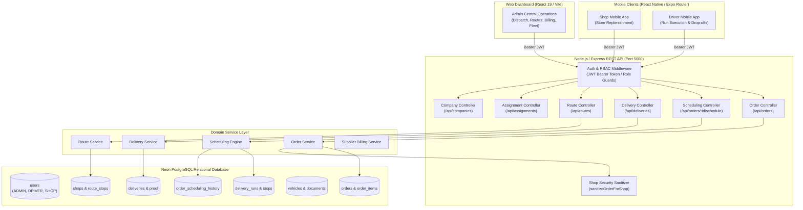
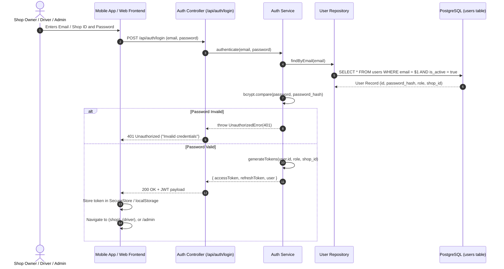
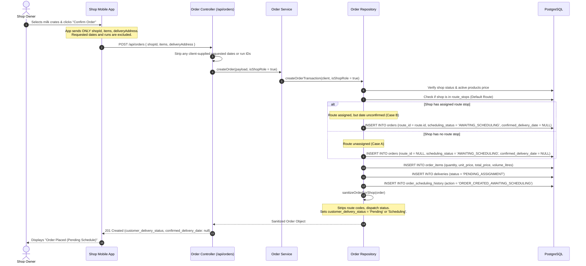
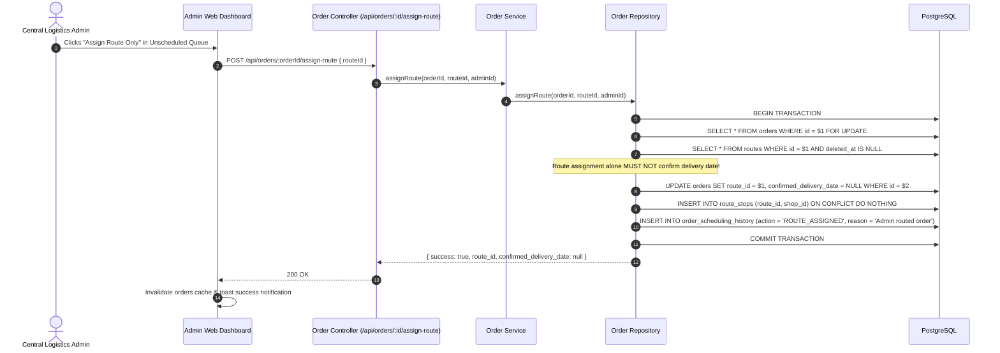
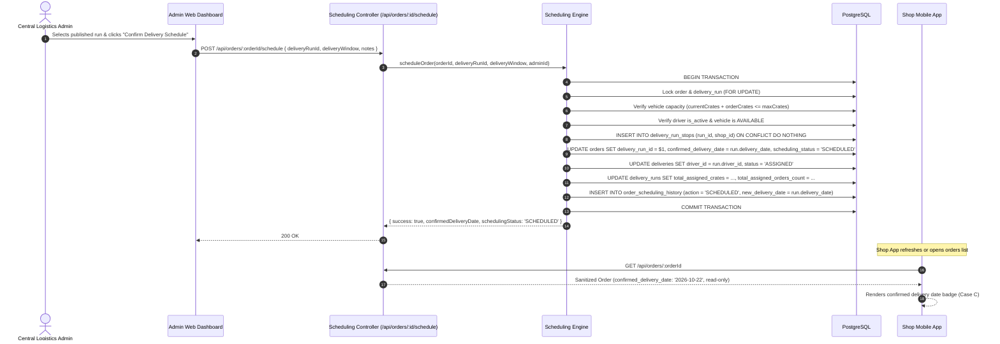
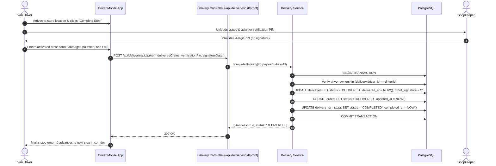
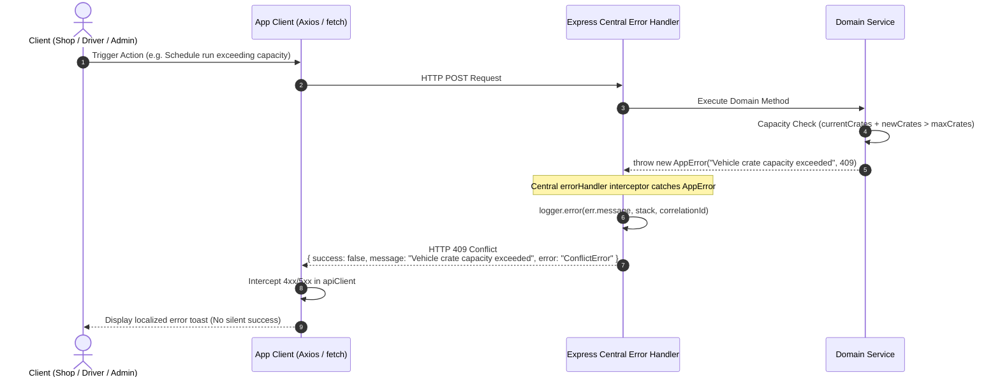

# 03 — System Architecture & Workflow Sequences

## 1. High-Level Architecture Diagram

---

## 2. Sequence Diagrams

### 2.1 Sequence 1: User Login & Session Bootstrap

---

### 2.2 Sequence 2: Shop Placing an Order (Zero Date Control)

---

### 2.3 Sequence 3: Admin Assigning a Route (Case B Transition)

---

### 2.4 Sequence 4: Admin Confirming a Delivery Schedule (Case C Transition)

---

### 2.5 Sequence 5: Driver Executing & Completing a Stop

---

### 2.6 Sequence 6: Failed Request & Centralized Error Handling Flow

