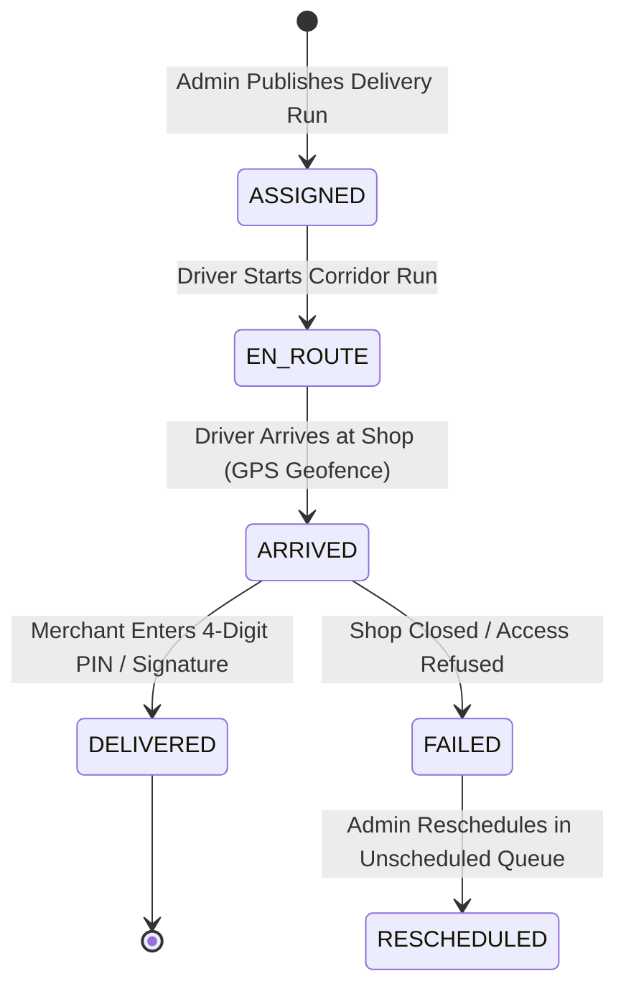

# 05 — Driver Mobile Application Feature Audit

## 1. Application Overview

The **Driver Mobile Application** is located in `Delivshop/app/(driver)/` and shares the same Expo React Native codebase as the Shop portal, switching context based on authenticated user role (`DRIVER`). It equips delivery van drivers with an operational workflow covering vehicle pre-trip inspection, supplier dairy collection verification, sequenced store dropoffs, merchant PIN proof-of-delivery, damaged goods logging, and shift reconciliation.

---

## 2. Authentication & Driver Profile (`app/(auth)/driver-login.tsx`)

### 2.1 Login & Security
- **Credentials:** Driver Code / Employee ID (e.g. `DRV-PUN-014`) or Phone/Email, plus secure Password.
- **Role Verification:** Authenticates against `POST /api/auth/login`. Rejects non-driver logins from accessing driver tabs.
- **Profile Screen (`app/(driver)/(tabs)/profile.tsx`):**
  - Displays Driver Name, Employee Code, Active License Number, Emergency Contact.
  - Displays currently assigned Vehicle (`MH-12-AL-1234`), Refrigeration Type, and Active Route Corridor.
  - Read-only protection: Driver cannot modify license expiry or vehicle allocations; updates require Admin intervention.

---

## 3. Pre-Trip & Shift Workflows

### 3.1 Shift Start & Inspection (`app/(driver)/shift-start.tsx` & `inspection.tsx`)
1. **Odometer Reading:** Driver logs starting vehicle odometer in kilometers.
2. **Refrigeration Check:** Verification that the vehicle chiller unit is operational and cargo temperature is below 4°C.
3. **Vehicle Condition Checklist:** Tires, lights, cleanliness, cold curtain integrity, and mandatory documents (RC book, commercial insurance) checked.
4. **Submission:** Sends inspection payload to backend; activates driver status to `ON_DUTY`.

### 3.2 Shift End & Empty Crate Reconciliation (`app/(driver)/shift-end.tsx` & `reconciliation.tsx`)
1. **Closing Odometer:** Calculation of total daily trip distance.
2. **Crate Balance Verification:**
   - Total crates loaded at supplier collection vs crates dropped at retail shops.
   - Empty crates retrieved from merchants and returned to supplier depot.
3. **Discrepancy Reporting:** Notes any missing empty crates or leaked pouches.

---

## 4. Supplier Dairy Collection Workflow (`app/(driver)/(tabs)/collections.tsx`)

Before commencing store drop-offs, the driver must visit the designated supplier dairy (e.g., Katraj Dairy / Chitale Bandhu):
1. **Collection Requirements Screen:** Displays total required crates broken down by SKU:
   - e.g. 50 Crates Standard Toned Milk (1200 pouches)
   - e.g. 30 Crates Whole Cow Milk (720 pouches)
   - e.g. 10 Crates Fresh Malai Paneer (200 packs)
2. **Batch & Temperature Capture:** Driver logs supplier dispatch batch number and initial loading temperature (°C).
3. **Supplier Verification:** Clicks "Confirm Collection". Backend records timestamp and advances run status to `DISPATCHED`.

---

## 5. Sequenced Delivery Execution (`app/(driver)/(tabs)/deliveries.tsx` & `delivery/[id].tsx`)

### 5.1 Route Navigation & Shop Stop List
- **Sequenced Stops:** Stops are sorted in optimized delivery order (`stop_sequence = 1, 2, 3...`).
- **Store Cards:** Display Merchant Name, Address, Total Crates to drop, Contact Phone (with one-touch call button), and Google Maps / navigation trigger.
- **Map Integration:** Opens native map application (Google Maps / Apple Maps) pre-loaded with destination coordinates (`latitude`, `longitude`).

### 5.2 Proof of Delivery (POD) & Verification
- **Drop Verification:** Driver inputs actual delivered crates and any damaged or returned items.
- **Customer Authentication (PIN or Signature):**
  - **4-Digit Shop PIN:** Merchant supplies their secure secret PIN shown in their own Shop app.
  - **Digital Signature:** Merchant draws digital signature directly on the touchscreen.
- **Timestamp & Geolocation:** POD records exact device timestamp and GPS coordinate tag.
- **Submission:** Calls `POST /api/deliveries/:deliveryId/proof`. Atomically transitions order status to `DELIVERED`.

---

## 6. Incident Reporting (`app/(driver)/incident.tsx`)

Enables drivers to report unexpected route anomalies:
- **Incident Categories:** `VEHICLE_BREAKDOWN`, `ACCIDENT`, `REFRIGERATION_FAILURE`, `TRAFFIC_DELAY`, `CUSTOMER_DISPUTE`.
- **Severity Rating:** `LOW`, `MEDIUM`, `HIGH`, `CRITICAL`.
- **Evidence Attachment:** Camera integration allowing drivers to photograph vehicle tire puncture, refrigeration temperature gauge, or damaged crates.
- **Real-Time Notification:** Generates high-priority notification on the Admin Web Dashboard for immediate route re-assignment or backup van dispatch.
