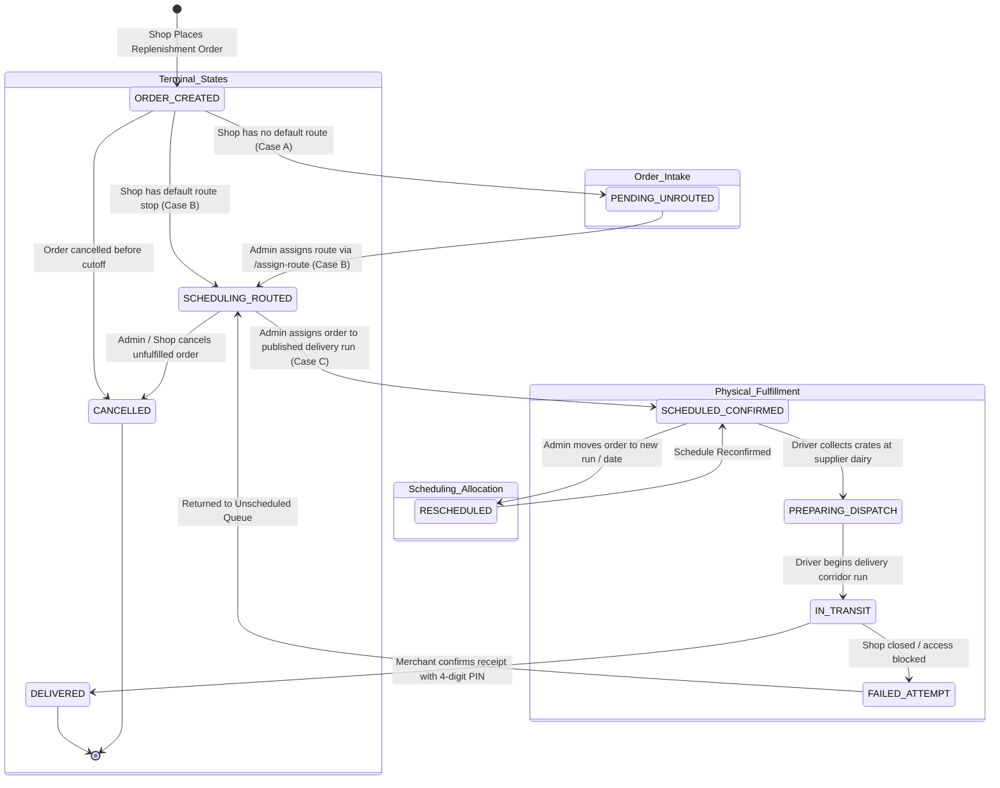

# 07 — Business Workflows, Order Lifecycle & State Machines

## 1. Unified State Machine Diagram

---

## 2. Order Lifecycle Transition Matrix

| Initial State | Action / Trigger | Authorized Role | Responsible Service / API | Database Mutations | Validation Rules | Resulting Order State | Shop UI Status | Admin Dashboard Status | Driver UI Status |
| :--- | :--- | :--- | :--- | :--- | :--- | :--- | :--- | :--- | :--- |
| **None** | Shop Submits Order | `SHOP` | `order.service.ts` `POST /api/orders` | `INSERT INTO orders` `INSERT INTO order_items` `INSERT INTO deliveries` | Product must be active; credit limit check; idempotency key check. | `PENDING` (route_id: null or default) | **`Pending`** (Case A) or **`Scheduling`** (Case B) | `PENDING_CONFIRMATION` (Awaiting Scheduling) | Not Visible |
| **Case A (`Pending`)** | Admin Assigns Route | `ADMIN`, `SUPPLIER` | `order.service.ts` `POST /api/orders/:id/assign-route` | `UPDATE orders SET route_id = $1` `INSERT INTO route_stops` `INSERT INTO order_scheduling_history` | Target route must exist and be active; order not cancelled. | `PENDING` (route_id: valid UUID) | **`Scheduling`** (Case B) | `PENDING_CONFIRMATION` (Routed) | Not Visible |
| **Case B (`Scheduling`)** | Admin Schedules Run | `ADMIN`, `SUPPLIER` | `scheduling.service.ts` `POST /api/orders/:id/schedule` | `UPDATE orders SET delivery_run_id = $1, confirmed_delivery_date = $2, scheduling_status = 'SCHEDULED'` `UPDATE deliveries SET driver_id = $3` | Run must be active/published; van crate capacity check; driver active check. | `CONFIRMED` / `PREPARING` | **`[Confirmed Date]`** (Case C, read-only) | `DISPATCH_PREPARED` (Scheduled) | Visible in Upcoming Run Manifest |
| **Case C (`Scheduled`)** | Admin Reschedules Run | `ADMIN`, `SUPPLIER` | `scheduling.service.ts` `POST /api/orders/:id/reschedule` | `UPDATE orders SET delivery_run_id = $new, confirmed_delivery_date = $new` `INSERT INTO order_scheduling_history` | Mandatory reason string (>=3 chars); capacity check on target run. | `CONFIRMED` / `PREPARING` | **`[Updated Confirmed Date]`** | `DISPATCH_PREPARED` (Rescheduled) | Updated in Driver Manifest |
| **Scheduled** | Driver Collects at Supplier | `DRIVER` | `collection.service.ts` `POST /api/collections/verify` | `UPDATE delivery_runs SET status = 'DISPATCHED'` `INSERT INTO delivery_collections` | Temperature check (<4°C); crate count match. | `PREPARING` | **`[Confirmed Date]`** | `DISPATCH_PREPARED` (Collected) | Crates Loaded in Van |
| **Preparing** | Driver Starts Route | `DRIVER` | `delivery.service.ts` `PATCH /api/deliveries/:id/status` | `UPDATE orders SET status = 'IN_TRANSIT'` `UPDATE deliveries SET status = 'EN_ROUTE_DROPOFF'` | Driver assigned to run; pre-trip inspection completed. | `IN_TRANSIT` | **`In Transit`** (Driver contact revealed) | `IN_TRANSIT` | Stop Active / Navigating |
| **In Transit** | Merchant PIN Verification | `DRIVER`, `SHOP` | `delivery.service.ts` `POST /api/deliveries/:id/proof` | `UPDATE deliveries SET status = 'DELIVERED', delivered_at = NOW()` `UPDATE orders SET status = 'DELIVERED'` `UPDATE delivery_run_stops SET status = 'COMPLETED'` | 4-digit PIN match OR digital signature bitmap provided; delivered crates logged. | `DELIVERED` | **`Delivered`** (Confirmed by PIN) | `DELIVERED` (Drop Verified) | Stop Completed (Green Check) |
| **In Transit** | Failed Dropoff Attempt | `DRIVER` | `delivery.service.ts` `PATCH /api/deliveries/:id/status` | `UPDATE deliveries SET status = 'FAILED', notes = $reason` `UPDATE orders SET status = 'DISPUTED'` | Reason required (`STORE_CLOSED`, `REFUSED`, `ROAD_BLOCKED`). | `DISPUTED` | **`Delivery Attempt Failed`** | `DISPUTED` (Requires Attention) | Stop Marked Red |

---

## 3. Resolution of the Route Assignment & Status Synchronization Bug

### 3.1 Historical Bug Anatomy
Previously, an order assigned to a route would continue displaying `AWAITING SCHEDULING` and `PENDING_ASSIGNMENT` on the Shop mobile app, or falsely display provisional delivery dates.

### 3.2 Root Causes Identified
1. **Conflated Conceptions:** Route Assignment (associating an order with a geographic delivery corridor like `RT-PUN-01`) was conflated with Delivery Run Scheduling (booking physical space on a van with an assigned driver for a specific morning).
2. **Raw Internal Data Leaks:** The Shop API query joined `deliveries d` and `routes r`, directly projecting `d.status = 'PENDING_ASSIGNMENT'` and `r.name = 'Route Service: nashik'` into the Shop mobile JSON response.
3. **Missing Intermediate Route-Only Mutation Endpoint:** The backend only permitted scheduling an order directly to a `delivery_run_id`. There was no standalone route assignment endpoint.

### 3.3 The Verified Architectural Solution
1. **Explicit API Endpoint Added:** `POST /api/orders/:orderId/assign-route` allowing Admins to assign a route independently of delivery run booking.
2. **Server-Side Sanitization Transformer (`sanitizeOrderForShop`):**
   - Automatically derives `customer_delivery_status` according to the 3-case rule:
     - Route `NULL` -> `Pending`
     - Route NOT `NULL`, Date `NULL` -> `Scheduling`
     - Route NOT `NULL`, Date NOT `NULL` -> Confirmed Date
   - Strips internal route codes, dispatch status codes (`PENDING_ASSIGNMENT`), optimization notes, and scheduler user IDs.
3. **Strict Date Clearing on Route Assignment:** Assigning a route alone strictly ensures `confirmed_delivery_date = NULL`, preventing unconfirmed dates from surfacing to merchants.
