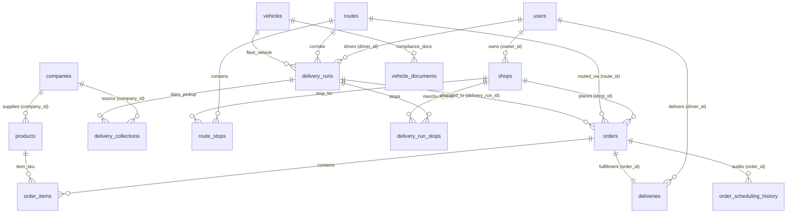

# 09 — Complete Database Schema & Migrations

## 1. Entity Relationship (ER) Diagram

---

## 2. Core Tables Specification

### 2.1 `users`
- **Purpose:** Central authentication entity for Admins, Drivers, Suppliers, and Shopkeepers.
- **Columns:**
  - `id` (UUID, Primary Key, `gen_random_uuid()`)
  - `email` (VARCHAR(255), UNIQUE, NOT NULL)
  - `password_hash` (VARCHAR(255), NOT NULL, bcrypt)
  - `name` (VARCHAR(255), NOT NULL)
  - `role` (ENUM: `'ADMIN'`, `'SUPPLIER'`, `'SHOP'`, `'DRIVER'`, NOT NULL)
  - `phone` (VARCHAR(50))
  - `is_active` (BOOLEAN, DEFAULT true, NOT NULL)
  - `created_at` / `updated_at` (TIMESTAMPTZ, DEFAULT NOW())

### 2.2 `shops`
- **Purpose:** Retail merchants / store storefronts placing replenishment orders.
- **Columns:**
  - `id` (UUID, Primary Key)
  - `shop_id` (VARCHAR(50), UNIQUE, e.g. `SH-PUN-014`)
  - `name` (VARCHAR(255), NOT NULL)
  - `owner_id` (UUID, FK -> `users(id)`)
  - `email` (VARCHAR(255), NOT NULL)
  - `phone` (VARCHAR(50), NOT NULL)
  - `address` (TEXT, NOT NULL)
  - `latitude` / `longitude` (NUMERIC(10, 7), coordinates for GPS geofencing & map routing)
  - `delivery_window` (VARCHAR(100), DEFAULT `'06:00 AM - 09:00 AM'`)
  - `credit_limit` / `outstanding_balance` (NUMERIC(12, 2))
  - `verification_pin` (VARCHAR(4), DEFAULT `'1234'`, merchant proof-of-delivery PIN)
  - `status` (VARCHAR(50), DEFAULT `'ACTIVE'`)

### 2.3 `routes` & `route_stops`
- **`routes`:**
  - `id` (UUID, Primary Key)
  - `code` (VARCHAR(50), UNIQUE, e.g. `RT-PUN-01`)
  - `name` (VARCHAR(255), NOT NULL)
  - `city` (VARCHAR(100), NOT NULL)
  - `estimated_duration_mins` (INTEGER, DEFAULT 120)
  - `status` (VARCHAR(50), DEFAULT `'ACTIVE'`)
  - `deleted_at` (TIMESTAMPTZ, soft delete support)
- **`route_stops`:**
  - `id` (UUID, Primary Key)
  - `route_id` (UUID, FK -> `routes(id)` ON DELETE CASCADE)
  - `shop_id` (UUID, FK -> `shops(id)` ON DELETE CASCADE)
  - `stop_sequence` (INTEGER NOT NULL)
  - `UNIQUE (route_id, shop_id)`

### 2.4 `vehicles` & `vehicle_documents`
- **`vehicles`:**
  - `id` (UUID, Primary Key)
  - `registration_number` (VARCHAR(50), UNIQUE, e.g. `MH-12-AL-1234`)
  - `type` (VARCHAR(50), DEFAULT `'REFRIGERATED_TRUCK'`)
  - `capacity_litres` (NUMERIC(10, 2))
  - `crate_capacity` / `capacity_crates` (INTEGER, standard van limit 80–120 crates)
  - `status` (ENUM: `'AVAILABLE'`, `'ASSIGNED'`, `'UNDER_MAINTENANCE'`, `'INACTIVE'`)
  - `is_active` (BOOLEAN, DEFAULT true)
- **`vehicle_documents`:**
  - `id` (UUID, Primary Key)
  - `vehicle_id` (UUID, FK -> `vehicles(id)`)
  - `document_type` (ENUM: `'RC_BOOK'`, `'COMMERCIAL_INSURANCE'`, `'PUC'`, `'FITNESS'`)
  - `document_number` (VARCHAR(100))
  - `expiry_date` (DATE)
  - `file_url` (TEXT)
  - `status` (ENUM: `'VALID'`, `'EXPIRING_SOON'`, `'EXPIRED'`)

### 2.5 `delivery_runs` & `delivery_run_stops`
- **`delivery_runs`:**
  - `id` (UUID, Primary Key)
  - `run_code` (VARCHAR(100), UNIQUE, e.g. `RUN-20261022-PUN01`)
  - `route_id` (UUID, FK -> `routes(id)`)
  - `driver_id` (UUID, FK -> `users(id)`)
  - `vehicle_id` (UUID, FK -> `vehicles(id)`)
  - `delivery_date` (DATE NOT NULL)
  - `delivery_window` (VARCHAR(100), DEFAULT `'06:00 AM - 09:00 AM'`)
  - `total_assigned_crates` (NUMERIC(10, 2), DEFAULT 0)
  - `total_assigned_orders_count` (INTEGER, DEFAULT 0)
  - `is_published` (BOOLEAN, DEFAULT false)
  - `status` (ENUM: `'DRAFT'`, `'ASSIGNED'`, `'PUBLISHED'`, `'DISPATCHED'`, `'COMPLETED'`, `'CANCELLED'`)
  - `uq_driver_run_date` (UNIQUE: `(driver_id, delivery_date)`)
- **`delivery_run_stops`:**
  - `id` (UUID, Primary Key)
  - `run_id` (UUID, FK -> `delivery_runs(id)` ON DELETE CASCADE)
  - `shop_id` (UUID, FK -> `shops(id)`)
  - `stop_sequence` (INTEGER NOT NULL)
  - `status` (ENUM: `'PENDING'`, `'IN_TRANSIT'`, `'COMPLETED'`, `'FAILED'`)
  - `completed_at` (TIMESTAMPTZ)

### 2.6 `orders` & `order_items`
- **`orders`:**
  - `id` (UUID, Primary Key)
  - `order_number` (VARCHAR(50), UNIQUE, e.g. `ORD-20261018-ZMUS`)
  - `shop_id` (UUID, FK -> `shops(id)`)
  - `route_id` (UUID, FK -> `routes(id)`, NULLABLE — Case A is NULL, Case B is NOT NULL)
  - `delivery_run_id` (UUID, FK -> `delivery_runs(id)`, NULLABLE — Case C is NOT NULL)
  - `requested_delivery_date` (DATE, administrative/requested notes)
  - `confirmed_delivery_date` (DATE, NULLABLE — authoritative confirmed schedule date)
  - `delivery_window` (VARCHAR(100))
  - `scheduling_status` (ENUM: `'AWAITING_SCHEDULING'`, `'SCHEDULED'`, `'RESCHEDULED'`, `'OUT_FOR_DELIVERY'`, `'DELIVERED'`)
  - `status` (ENUM: `'PENDING'`, `'CONFIRMED'`, `'PREPARING'`, `'READY_FOR_PICKUP'`, `'IN_TRANSIT'`, `'DELIVERED'`, `'CANCELLED'`)
  - `subtotal` / `tax_amount` / `delivery_fee` / `total` (NUMERIC(12, 2))
  - `total_crates_count` (NUMERIC(10, 2))
  - `total_volume_litres` (NUMERIC(10, 3))
  - `total_packages_count` (INTEGER)
  - `idempotency_key` (VARCHAR(255), UNIQUE)
- **`order_items`:**
  - `id` (UUID, Primary Key)
  - `order_id` (UUID, FK -> `orders(id)` ON DELETE CASCADE)
  - `product_id` (UUID, FK -> `products(id)`)
  - `quantity` (INTEGER NOT NULL)
  - `unit_price` / `total_price` (NUMERIC(10, 2))
  - `volume_litres` (NUMERIC(10, 3))
  - `crates_count` (NUMERIC(10, 2))

### 2.7 `deliveries` & `order_scheduling_history`
- **`deliveries`:**
  - `id` (UUID, Primary Key)
  - `order_id` (UUID, FK -> `orders(id)`, UNIQUE)
  - `driver_id` (UUID, FK -> `users(id)`, NULLABLE until run scheduled)
  - `status` (ENUM: `'PENDING_ASSIGNMENT'`, `'ASSIGNED'`, `'EN_ROUTE_DROPOFF'`, `'DELIVERED'`, `'FAILED'`)
  - `delivered_at` (TIMESTAMPTZ)
  - `proof_signature` / `proof_pin` (TEXT)
  - `delivered_crates` (INTEGER)
  - `damaged_quantity` (INTEGER DEFAULT 0)
- **`order_scheduling_history` (Audit Log):**
  - `id` (UUID, Primary Key)
  - `order_id` (UUID, FK -> `orders(id)`)
  - `action` (VARCHAR(100), e.g. `'ORDER_CREATED_AWAITING_SCHEDULING'`, `'ROUTE_ASSIGNED'`, `'SCHEDULED'`, `'RESCHEDULED'`)
  - `previous_delivery_date` / `new_delivery_date` (DATE)
  - `previous_delivery_run_id` / `new_delivery_run_id` (UUID)
  - `reason` (TEXT)
  - `actor_id` (UUID, FK -> `users(id)`)
  - `created_at` (TIMESTAMPTZ, DEFAULT NOW())

---

## 3. PostgreSQL Migrations Map (`001` through `025`)

1. `001_initial_schema.sql`: Core enums, users, shops, suppliers, products, orders, deliveries.
2. `002_shop_management.sql`: Shop verification PIN, outstanding balance, credit limit.
3. `003_order_idempotency.sql`: Idempotency keys on orders.
4. `004_shop_documents.sql`: KYC and FSSAI license document tables.
5. `005_company_management.sql`: Supplier dairy company structures and contact models.
6. `006_products_and_inventory.sql`: Packaging specs (pouch, cup, pack, liquid flag).
7. `007_deactivation_first_deletion.sql`: Soft deletion patterns with `deleted_at`.
8. `008_drivers_roster.sql`: Commercial driver profiles, Aadhaar, license metadata.
9. `009_fleet_routes_assignments.sql`: Routes, stops, vehicles, and delivery run tables.
10. `010_expand_routes_status_and_metrics.sql`: Route activation toggles and duration metrics.
11. `011_route_code_counters.sql`: Atomic route code sequences.
12. `012_driver_management_system.sql`: Shift state, attendance, vehicle assignment.
13. `013_driver_and_vehicle_management_enhancements.sql`: Pre-trip inspection logs.
14. `014_vehicle_fleet_enterprise_enhancements.sql`: Commercial insurance and RC document tracking.
15. `015_driver_inspections_incidents_delivery_completion.sql`: Incident reporting & GPS geofencing.
16. `016_assignment_deletion_and_lifecycle_enhancements.sql`: Safe assignment teardown guards.
17. `017_orders_dispatch_and_packaging_enhancements.sql`: Crate and volume aggregate fields on orders.
18. `018_route_based_scheduling.sql`: Order scheduling history audit table and run stops.
19. `019_company_coordinates_and_pickup_fulfillment.sql`: Geocoordinates for dairy supplier factories.
20. `020_shop_order_reminders.sql`: Merchant daily order cutoff reminders.
21. `021_supplier_billing_and_pickup_verification.sql`: Supplier billing ledgers and collection verification.
22. `022_retire_warehouse_inventory_dependencies.sql`: Archives warehouse tables in favor of direct fulfillment.
23. `023_ensure_inventory_archive_tables.sql`: Historical inventory ledger preservation.
24. `024_canonical_units_and_schema_repair.sql`: Standardizes packaging units (Litres, kg, pouches).
25. `025_inventory_movement_counters.sql`: Atomic counters for collection dispatch receipts.
